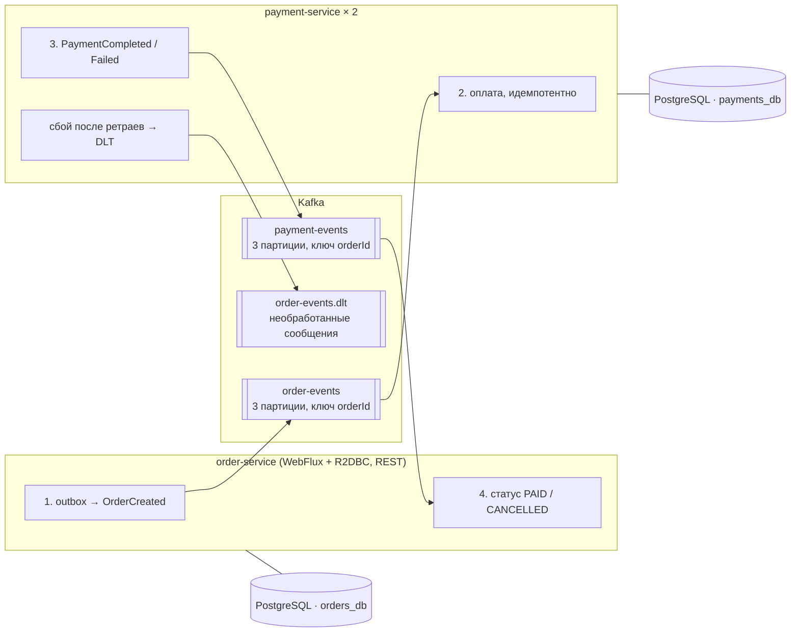

# Цель и границы
Нужно 40-100 часов собрать систему из двух сервисов, которая принимает заказ, асинхронно проводит оплату и переводит заказ в PAID или CANCELLED.

Проект учебный: каждая фича существует ради одной технологии из плана развития, бизнес-логика намеренно упрощена.

# План
| Пункт плана | Критерии |
| --- | --- |
| PostgreSQL | 5 млн заказов + запросы с планами выполнения до и после индексов |
| Kafka | Два топика по три партиции, группа из двух потребителей, ретраи и DLT |
| Микросервисная архитектура | Сага-хореография, transactional outbox, idempotent consumer, database per service |
| Реактивное программирование | order-service на WebFlux + R2DBC + ReactiveKafka |
| Многопоточность Java | ??? |
| Grafana | Дашборд для CPU/RAM/HDD/Нагрузка на кафку/DB/Колличество записей в DLT и алерты |

**По желанию:**

- авторизация, UI, Kubernetes, CI/CD;
- API gateway, service discovery, config server;
- третий сервис (склад, уведомления);
- покрытие тестами сверх двух-трёх интеграционных на Testcontainers.

## Архитектура

Два сервиса общаются только событиями через Kafka, синхронных вызовов между ними нет. У каждого своя база данных в одном инстансе PostgreSQL.



Поток саги:

1. Клиент вызывает `POST /api/orders`. order-service в одной транзакции пишет заказ со статусом `NEW` и строку в `outbox`.
2. Outbox-relay читает неотправленные строки и публикует `OrderCreated` в `order-events`.
3. payment-service получает событие, проверяет, что не обрабатывал его раньше, имитирует оплату и публикует `PaymentCompleted` или `PaymentFailed` в `payment-events`.
4. order-service получает результат, переводит заказ в `PAID` или `CANCELLED` и отправляет новый статус.
5. Если payment-service не смог обработать сообщение за три попытки, оно уходит в `order-events.dlt`, а заказ остаётся в `NEW`. Такие «зависшие» заказы находит отдельный запрос.

Доставка везде at-least-once: дубли возможны на каждом шаге, поэтому оба потребителя обязаны быть идемпотентными.


## Стек и структура репозитория

Один монорепозиторий, два модуля сервисов, вся инфраструктура в docker-compose.

| Что | Чем |
| --- | --- |
| Язык и сборка | Java 21+, Maven (multi-module), актуальный Spring Boot |
| order-service | Spring WebFlux, Spring Data R2DBC, Flyway, spring-kafka |
| payment-service | Spring Boot (обычный, блокирующий), JDBC, Flyway, spring-kafka |
| Брокер | Kafka, один брокер в режиме KRaft |
| База | Один контейнер PostgreSQL, две базы: `orders_db` и `payments_db` |
| Метрики | Micrometer, Spring Boot Actuator, Prometheus, Grafana |
| Нагрузка | k6 или простой скрипт |
| Тесты | JUnit 5, Testcontainers (PostgreSQL, Kafka) |

payment-service намеренно блокирующий: на защите нужно сравнить две модели исполнения на собственном коде.

```
order-processing/
  pom.xml
  docker-compose.yml
  mise.toml                  # задачи: up, down, seed, load
  order-service/
    src/main/java/...
    src/main/resources/db/migration/   # Flyway
  payment-service/
    src/main/java/...
    src/main/resources/db/migration/
  infra/
    postgres/init.sql        # создание двух баз
    prometheus/prometheus.yml
    grafana/provisioning/    # datasource + дашборд как JSON
  scripts/
    seed.sql                 # 5 млн заказов
    load.js                  # сценарий k6
  docs/
    postgres-report.md       # планы до и после
  README.md
```

В docker-compose поднимаются: `postgres`, `kafka`, `prometheus`, `grafana`, `order-service`, `payment-service` в двух экземплярах. Всё стартует одной командой, например `mise run up`. Дашборд и datasource Grafana подключаются через provisioning, руками в UI после старта ничего настраивать не нужно.

## Чек-лист приёмки

Проект принят, когда закрыты все пункты ниже. Каждый пункт проверяется демонстрацией или файлом в репозитории.

### Общее

- [ ] Репозиторий на GitHub, история коммитов отражает этапы работы
- [ ] Вся система поднимается одной командой на чистой машине с Docker
- [ ] README содержит схему, инструкцию запуска, скриншот дашборда и результаты экспериментов
- [ ] Есть минимум два интеграционных теста на Testcontainers: счастливый путь саги и повторная доставка события

### PostgreSQL

- [ ] База засеяна: 5 млн заказов, 2 млн строк outbox
- [ ] В отчёте четыре запроса с планами до и после
- [ ] Использованы составной, частичный и покрывающий индексы, каждый обоснован
- [ ] Список заказов работает на keyset-пагинации, в отчёте есть сравнение с `OFFSET`
- [ ] Показан запрос, где индекс есть, но планировщик выбирает Seq Scan, с объяснением
- [ ] Измерено влияние индексов на скорость вставки
- [ ] Инженер читает любой из своих планов вслух: узлы, cost, rows, buffers

### Kafka

- [ ] Топики созданы явно, по три партиции, ключ сообщения `orderId`
- [ ] Два экземпляра payment-service работают в одной группе и делят партиции
- [ ] Оффсеты подтверждаются вручную после обработки
- [ ] Показан ребаланс при остановке экземпляра
- [ ] «Ядовитое» сообщение после трёх попыток оказывается в `order-events.dlt`
- [ ] Инженер объясняет at-least-once, порядок внутри партиции, роль `acks` и идемпотентного продюсера

### Микросервисная архитектура

- [ ] Сервисы не вызывают друг друга синхронно и не читают чужую базу
- [ ] Заказ и событие пишутся в одной транзакции через outbox
- [ ] Повторная доставка `OrderCreated` не создаёт второй платёж
- [ ] Повторная доставка результата оплаты не меняет финальный статус заказа
- [ ] После `kill -9` любого сервиса под нагрузкой все заказы, кроме ушедших в DLT, доходят до финального статуса
- [ ] Инженер сравнивает хореографию с оркестрацией и называет компенсирующее действие в своей саге

### Реактивное программирование

- [ ] order-service на WebFlux и R2DBC, в коде нет `.block()` и блокирующих драйверов
- [ ] BlockHound подключён в тестах, тесты зелёные
- [ ] SSE-стрим отдаёт смену статуса и завершается на финальном статусе
- [ ] Есть тест на `StepVerifier`
- [ ] Инженер отвечает на вопросы по реактивному программированию из раздела теории

### Многопоточность Java

- [ ] Два outbox-relay работают одновременно и не отправляют одну строку дважды
- [ ] Потребитель работает с `concurrency = 3`, инженер объясняет распределение потоков по партициям
- [ ] Инженер отвечает на вопросы по Java Concurrency из раздела теории

### Grafana

- [ ] Дашборд из восьми панелей поднимается из репозитория через provisioning
- [ ] Реализованы пять собственных метрик
- [ ] Под нагрузкой по дашборду видны остановка payment-service и восстановление после неё
- [ ] Алерт на consumer lag переходит в Firing и обратно в Normal
- [ ] Инженер объясняет любой свой PromQL-запрос, включая `rate` и `histogram_quantile`

